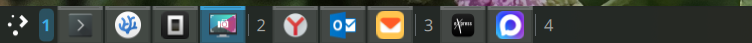

# Desktops + Taskbar

Форк стандартных виджетов Plasma 6 **Task Manager** и **Icons-Only Task Manager**:
панель задач, в которой задачи сгруппированы по виртуальным рабочим столам.

Каждая группа начинается с подписи своего стола, поэтому виджет заодно работает
индикатором рабочих столов. Приложения закрепляются за конкретным столом, а окна
перетаскиваются между столами вместе со своими закреплениями.



На снимке — вариант «только иконки»: группы начинаются с подписи рабочего стола
(`1`, `2`, …), текущий стол подсвечен, пустые столы тоже видны.

## Возможности

- **Группы по рабочим столам**: `[1|иконки][2|иконки]` — подпись стола и следом окна этого стола.
- **Индикатор столов**: столы без окон не исчезают, текущий подсвечен, клик по подписи переключает стол.
- **Закрепление за столом**: ПКМ по окну → «Закрепить за столом …»; закреплённый пункт запускается на этом столе.
- **Клик по закреплённому приложению чужого стола** сначала переключает на этот стол, потом запускает приложение.
- **Перетаскивание**: смена порядка закреплённых иконок, перенос окна (вместе с закреплением) на другой стол.
- **Meta+1…0** нумерует задачи в пределах текущего рабочего стола.
- При выключенной группировке (`groupByDesktop: false`) виджет ведёт себя как апстримный.

## Требования

Написано и проверено на KDE Plasma 6.3.6 (KF6 6.13, Qt 6.8, Debian 13, Wayland).
Нужен `kpackagetool6` (идёт в составе Plasma 6).

## Установка

```bash
make install     # поставить оба пакета в ~/.local/share/plasma/plasmoids
make upgrade     # повторный install после правки QML
make status      # проверить, что пакеты видны
make diff        # diff с системным виджетом — что именно изменено
make uninstall   # убрать форк
```

В `/usr` ничего не перезаписывается: форк ставится под своими Id
(`local.vyuyukin.taskbar` и `local.vyuyukin.iconbar`), штатные виджеты и уже
настроенная панель остаются нетронутыми.

Если после установки виджета нет в списке — `systemctl --user restart plasma-plasmashell`
(KWin при этом не трогается, панель просто перерисуется).

Добавить на панель: ПКМ по панели → «Добавить элементы…» → «Окна и задачи» →
*Desktops + Taskbar* (с подписями окон) или *Desktops + Icon Taskbar* (только иконки).

Посмотреть без панели: `plasmawindowed local.vyuyukin.taskbar` (входит в Plasma) или
`plasmoidviewer -a local.vyuyukin.taskbar` (пакет `plasma-sdk`).

## Структура репозитория

```
package/                 # основной виджет — копия org.kde.plasma.taskmanager
├── metadata.json        # Id: local.vyuyukin.taskbar
└── contents/
    ├── config/          # main.xml (KConfigXT: настройки и дефолты), config.qml
    └── ui/              # main.qml, Task.qml, TaskList.qml, DesktopHeader.qml, ...
package-icontasks/       # пакет-обёртка «только иконки»
└── metadata.json        # Id: local.vyuyukin.iconbar + X-Plasma-RootPath на форк
docs/screenshot.png      # снимок панели для README
Makefile                 # install / upgrade / status / diff / package / uninstall
LICENSE                  # GPL-2.0
```

## Как это устроено

### «Только иконки» и `identity.js`

В апстриме Icons-Only Task Manager — **не отдельный код**, а пакет-обёртка
с `"X-Plasma-RootPath": "org.kde.plasma.taskmanager"` (один `metadata.json`,
ни строчки QML). Форк повторяет эту схему: `package-icontasks` ссылается на
`local.vyuyukin.taskbar`.

Поведение переключается по имени пакета:

```qml
readonly property bool iconsOnly: ForkIdentity.isIconsOnly(Plasmoid.pluginName)
```

В апстриме такая проверка разбросана по десятку мест (`layoutmetrics.js`,
`TaskBadgeOverlay.qml`, `ConfigBehavior.qml`, `ConfigAppearance.qml`), в форке она
сведена в один файл — `contents/ui/code/identity.js`:

```js
const PACKAGE_ID            = "local.vyuyukin.taskbar";
const ICONS_ONLY_PACKAGE_ID = "local.vyuyukin.iconbar";

function isIconsOnly(pluginName) {
    return pluginName === ICONS_ONLY_PACKAGE_ID
        || pluginName === "org.kde.plasma.icontasks"; // совместимость с апстримом
}
```

При смене Id виджета правятся `identity.js`, оба `metadata.json` и `TM_ID`/`ICON_ID`
в `Makefile`.

### Группировка по рабочим столам

Ключ конфига — `groupByDesktop` (по умолчанию **включён**). Раскладка «стол + его окна»:

```
[01|▓ ▓ ▓][02|▓ ▓][10|▓ ▓ ▓ ▓][11|]
 └ подпись   └ иконки только этого рабочего стола
```

- каждая группа — подпись стола (`DesktopHeader.qml`) и следом иконки окон этого стола;
- подпись — имя рабочего стола из KWin, а если имя пустое — его номер (1, 2, …);
- текущий стол подсвечен, клик по подписи переключает на него (`PagerModel.changePage`);
- столы без окон тоже видны (остаётся одна подпись) — это и есть индикатор столов;
- между группами тонкий разделитель.

Код: `DesktopHeader.qml` (подпись), группы — в `main.qml` (Repeater по
`virtualDesktopInfo.desktopIds`, свой `TaskManager.TasksModel` на стол),
`TaskList.qml` стал переиспользуемым (`taskModel` + `tasksRoot`).

Деталь реализации: `VirtualDesktopInfo.desktopNames` наполняется асинхронно и не
сигналит об этом (сигнал `desktopNamesChanged` приходит с ещё пустыми именами),
поэтому имена подтягиваются таймером в `tasks.desktopNames` — см. комментарий
в `main.qml`.

Действие каждой задачи и каждого пункта меню идёт **в модель своей группы**, поэтому
`taskModel` проброшен в `Task.qml`, `ContextMenu.qml`, `GroupDialog.qml`,
`ToolTipDelegate/Instance/WindowMouseArea`, `MouseHandler.qml` и `code/tools.js`.

### Закрепление приложения за рабочим столом

Лончеры в KDE про столы ничего не знают (`VirtualDesktops=[0]`,
`IsOnAllVirtualDesktops=true`), поэтому форк хранит закрепления сам — в конфиге
`launcherDesktops`, список строк `<desktopId>=<launcherUrl>`. **По умолчанию список
пуст**: закрепления штатного виджета (`launcherList`) в режиме групп не показываются
вообще.

- ПКМ по окну → «Закрепить за столом "01"» / «Открепить от стола "01"»
  (пункты подменяются только при включённом `groupByDesktop`);
- перетаскивание `.desktop` на виджет и запросы извне (`addLauncher`) тоже закрепляют
  за **текущим** столом;
- клик по закреплённому приложению чужого стола: виджет переключается на этот стол
  и только потом запускает приложение (ждёт смены `currentDesktop`, максимум ~2 с).

Код: `launchersFor()`, `addLauncherToDesktop()`, `removeLauncherFromDesktop()`,
`launchOnDesktop()` в `main.qml`; пункты меню — в `ContextMenu.qml`.

### Перетаскивание мышью

- **Порядок закреплённых** внутри стола: тащите иконку закреплённого приложения на
  другую закреплённую — порядок меняется сразу под курсором, как в апстриме.
  Механика (`applyPinDragStep`): `move()` в модели даёт немедленный отклик и обновляет
  внутреннюю карту ручной сортировки libtaskmanager, а сразу за ним переписывается
  конфиг `launcherDesktops` — иначе `TasksModel` вернёт прежний порядок из `launcherList`
  и иконка «отскочит».

  Одной записи конфига недостаточно: при том же наборе лончеров `setLauncherList` двигает
  строки через `moveRows`, но `sortedPreFilterRows` (карта ручной сортировки) обновляется
  только в `move()` — порядок применялся с задержкой в секунды, пока что-нибудь не
  спровоцирует пересортировку.

  Признак «закреплено» проверяется по конфигу (`isPinnedOnSourceDesktop`), а не по
  `IsLauncher`: у закреплённого приложения с открытым окном строка модели — окно.
  Целью перестановки должна быть тоже закреплённая иконка: дроп на строку незакреплённого
  окна порядок закреплений не меняет.

- **Окно на другой рабочий стол**: тащите иконку окна в другую группу (подпись стола
  подсвечивается) — у окна вызывается `requestVirtualDesktops(index, [desktopId])`.
- **Закрепление переезжает вместе с окном**: если приложение было закреплено за исходным
  столом, запись в `launcherDesktops` переносится на целевой стол.
- **Закрепление без окна** (лончер): тащите на другой стол — запись `launcherDesktops`
  просто меняет `desktopId`, приложение нигде не запускается.
- Внутри одного стола перетаскивание окон работает как в апстриме (только при
  «Сортировать вручную»), между группами — всегда.

Перенос применяется **дважды защищённо**: в `DropArea.onDropped` (если событие дошло и
`dragSource` ещё жив) и по завершении перетаскивания (когда `dragSource` обнуляется) —
порядок этих событий в Qt Quick не гарантирован, а в панели drop может не дойти до
виджета. Повторный вызов отсекается флагом `dragApplied`. Цель берётся из последней
позиции курсора (`dragOverGroup`/`dragOverItem`), поэтому важен сам факт «курсор был над
группой», а не событие drop.

Почему нельзя опираться только на drop: апстримный `MouseHandler.qml` внутренний drop
**отклоняет** (`accepted = false`) и меняет порядок закреплённых живьём, в
`onPositionChanged`, через `taskModel.move()`. У форка источник истины — `launcherDesktops`,
поэтому событие drop нужно, а панель тонкая (48px): если при отпускании курсор вышел за
её пределы, drop достаётся рабочему столу — в журнале это видно как `KIO::DropJob`
(`Arrived mimeData … text/uri-list`, `Creating menu for: "application/x-desktop"`).

Отдельная деталь: у строк-лончеров libtaskmanager отдаёт пустой `MimeType` и невалидный
`MimeData` (`AbstractTasksModel::data()`), из-за чего Qt не может собрать drag и
закрепления вообще не тащатся. `Task.qml` подставляет формат
`application/x-orgkdeplasmataskmanager_taskbuttonitem` с пустым значением — содержимое
для внутреннего переноса не нужно, важно лишь наличие формата.

Для диагностики в живой панели есть флаг `dndDebug` в `main.qml` (по умолчанию `false`):
при `true` все шаги перетаскивания пишутся в журнал
(`journalctl --user -u plasma-plasmashell`, строки `[dnd]`).

### Размер виджета в панели

В режиме групп ширину и высоту задаёт содержимое (`Layout.preferredWidth: groupsRow.width`,
`fillWidth/fillHeight = false`). Тонкость: если выразить `preferredWidth` через собственную
ширину апплета (`Math.min(width, groupsRow.width)`), биндинг залипает на
`Layout.minimumWidth` — апплет занимает 30x30 px, рисуя группы мимо себя (Qt не обрезает
детей без `clip`). Снаружи это выглядит нормально, но область перетаскивания тоже 30x30,
поэтому часть жестов до виджета просто не доходит.

Размер апплета в панели можно проверить без мыши:

```bash
qdbus6 org.kde.plasmashell /PlasmaShell org.kde.PlasmaShell.evaluateScript \
  'for (var i=0;i<panels().length;++i){var w=panels()[i].widgets();for(var j=0;j<w.length;++j)print(w[j].id+" "+w[j].type+" "+w[j].geometry)}'
```

В `plasmawindowed` этот дефект незаметен: окно подгоняется под `preferred*`, поэтому
раскладку и перетаскивание стоит проверять в самой панели.

### Быстрые клавиши Meta+1…0

Клавиши регистрирует **plasmashell** (`ShellCorona`, «Activate Task Manager Entry N»),
а сам виджет получает вызов `activateTaskAtIndex(QVariant)` — апплет ищется по
`X-Plasma-Provides: org.kde.plasma.multitasking`. То есть клавиши — часть виджета.

В режиме групп нумерация идёт **в рамках текущего рабочего стола**: Meta+1 — первая
иконка в группе активного стола, Meta+2 — вторая и т. д. При выключенной группировке
поведение как в апстриме — все задачи по порядку.

## Известные ограничения

| Ограничение | Причина |
|---|---|
| Колесо мыши по задачам в режиме групп не работает | нужен обход по всем группам |
| Если суммарная ширина групп больше панели — лишнее обрезается | нет прокрутки/сворачивания групп |
| Автопереноса окон на «свой» стол нет | нужен отдельный слой (KWin-правила или D-Bus) |
| Если удалить рабочий стол, его закрепления остаются в конфиге | записи по UUID, чистки нет |
| Пока приложение запускается, его иконка есть в моделях всех столов | стартовая задача не знает стола (`VirtualDesktops=[0]`); визуально она показана только в группе текущего стола, но `model.count` группы на секунду больше |

## Куда смотреть, когда допиливаешь

| Задача | Файл |
|---|---|
| Раскладка/поведение списка задач | `contents/ui/main.qml`, `TaskList.qml` |
| Подпись и подсветка рабочего стола | `DesktopHeader.qml` |
| Внешний вид одной иконки, бейджи, прогресс | `Task.qml`, `Badge.qml`, `TaskProgressOverlay.qml` |
| Клики, скролл, средняя кнопка, перетаскивание | `MouseHandler.qml` |
| Контекстное меню | `ContextMenu.qml` |
| Тултипы и превью окон | `ToolTipInstance.qml`, `ToolTipDelegate.qml`, `PipeWireThumbnail.qml` |
| Новые настройки | `contents/config/main.xml` (ключи + дефолты) и `ConfigAppearance.qml` / `ConfigBehavior.qml` |
| Вспомогательная логика | `contents/ui/code/tools.js`, `code/layoutmetrics.js` |
| Id пакета / «только иконки» | `contents/ui/code/identity.js` |

`main.qml` строит `TasksModel` (из `org.kde.taskmanager`), и дальше всё крутится вокруг
ролей модели — та же `TaskManager.TasksModel`, из которой Tasks Minimap читает
`Geometry` (роль 289). Поэтому «сортировка/группировка по позиции окна» делается там же,
где сейчас `sortingStrategy`.

## Апстрим

- `invent.kde.org/plasma/plasma-desktop` → `applets/taskmanager`
- Точная версия, с которой скопирован код: тег `v6.3.6`
  (пакет `plasma-desktop-data 4:6.3.6-2`)
- `make diff` показывает отличия от системного виджета — удобно при обновлении форка
  на новую версию Plasma

## Лицензия

GPL-2.0-or-later (см. `LICENSE`). Код — форк `applets/taskmanager` из KDE Plasma,
авторские права принадлежат участникам KDE (в частности Eike Hein); изменения форка
распространяются на тех же условиях.
